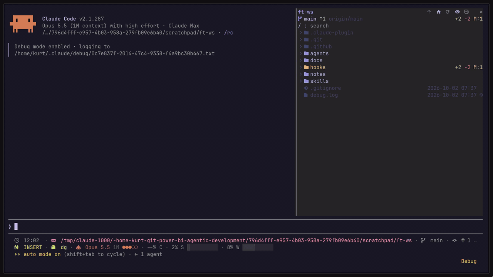

<h1 align="center">swarmtree</h1>

<p align="center">
  An IDE-style file tree for Claude Code that keeps up with a swarm of subagents: who is touching which file, in which worktree, and what changed
</p>

<p align="center">
  
  
  
  
</p>

> [!NOTE]
> swarmtree is a fork of [claude-code-filetree](https://github.com/data-goblin/claude-code-filetree) by Kurt Buhler, which gives it the tree, git status, the shimmer on what Claude touches and the settings below. It is a Claude Code **mod** and needs **Claude Code 2.1.306+**. It shows in the right sidebar, which in the terminal needs the fullscreen layout (`/tui fullscreen`) and a terminal at least 110 columns wide; the Desktop app docks it on its own, and `/swarmtree` reopens it there after you close it.

---

## Installation

The repo is its own plugin marketplace. Run this in the terminal:

```bash
claude plugin marketplace add BrunoVini/swarmtree
claude plugin install swarmtree@swarmtree
```

Or inside a Claude Code session:

```text
/plugin marketplace add BrunoVini/swarmtree
/plugin install swarmtree@swarmtree
```

Have the original filetree installed? Disable it (`/plugin`) so the two panes don't both open.

## Subagents

- Each subagent gets a color: a chip above the prompt (click it to open that subagent's transcript), a dot on its `Agent(...)` row, and a dot on every file and closed folder it read or wrote. Subagents spawned by subagents are shown under their parent
- Viewing a subagent's transcript shows only its work and its children's
- Subagents working in git worktrees are followed: their files light on the main tree, their commits get their dot in the graph, and their branches show as `⎇`
- Two live subagents writing the same file put a `⚠` on it and say so once
- Tab `4` lists each subagent with what it wrote (`✎`), read and last did; `d` opens its files, `o` a file's diff, the wheel scrolls
- What the subagents did is kept across `/reload-plugins`

## Peek and edit

- Double-click a file to see its diff against HEAD over the whole pane: `w`/`s`/`a`/`d` scroll, `n`/`p` jump between hunks, `t` switches to the diff in the worktree of a subagent that touched it, `q` goes back. Ctrl+click opens it in its default app
- `i` opens the file to type in (up to 1 MB, not binary): `save` lights up once something changed and Enter saves too; the file keeps its CRLF or LF, a file an agent changed since you opened it is only overwritten on a second save, and leaving with unsaved changes takes a second press
- The footer creates and deletes: `+ new` asks for a name and makes it in the folder under the cursor or of the selected file (`name/` makes a folder, `a/b.ts` the folders on the way); with a file selected, `✕ delete` asks first. Only files are deleted, only inside the tree; Linux and macOS

## Tabs

- `1` files, `2` only what git reports changed, `3` the commit graph in lanes with its branches and tags (double-click or `o` opens a commit's diff, file by file), `4` subagents

## The tree

- Interactive file tree for the working directory; it follows the cwd, or `/swarmtree <path>` pins another folder
- Typing a path at the prompt (`@src/a`, or anything with a `/`) opens the tree down to it while the cursor is in it: `⌕` found, `…` with the matches its last segment begins, `✗ path does not exist` otherwise; leaving the path puts the tree back
- Search the file tree, including folders you have not opened yet
- Git status per file and folder in color, with exact lines changed (`+N` `-N`) on modified files and `?:N M:N D:N` file counts on folders; branch, upstream and ahead/behind in the header
- Claude's reads and searches shimmer purple, writes orange and commits green; collapsed folders open to show the file. Git and GitHub operations show as a status at the bottom
- The selected file is passed to Claude as context, so "this" in a prompt means it
- File and folder sizes behind the `Σ` header button; on macOS, Space shows a file in Quick Look
- The git index and HEAD are polled, so staging and commits made outside Claude show up
- Nerd Font icons with a plain Unicode fallback; on Omarchy the pane follows the theme; a light `/config` theme gets its own palette at WCAG AAA contrast, subagent colors included

<p align="center">
  
</p>

### Keyboard

With the pane focused: `w`/`s` move up/down, `d` expands a folder, `a` collapses it or moves to its parent, `o` or Enter opens a file or toggles a folder, `f` focuses search, `y` copies the path, `1`-`4` switch tabs.

### Resizing the pane

You can resize the pane with the mouse, or by setting custom `pane:grow` or `pane:shrink` keybindings in `keybindings.json`.

## Settings

All settings are in `/config` under swarmtree.

- **Claude activity:** what shimmers: `reads and writes` (default), `writes`, `reads` or `none`. Git status, line counts and the git status at the bottom always show.
- **Follow Claude:** `on` (default) scrolls the tree to what Claude reads, writes or commits; `off` keeps the view where you put it, and highlights still show.
- **Open at start:** `on` (default) opens the pane when a session starts; `off` keeps it closed until you run `/swarmtree`.
- **Right column:** `date` (default), `age` or `size`; what the right column shows when a session starts. `age` shows how long ago a file changed in a few characters: `now`, `12m`, `3h`, `5d`, then the day (`Oct 9`) past a week and the year past a year. The `Σ` button in the header toggles between sizes and the dates or ages.
- **Hints:** `on` (default) shows a line under the header outside a git repo saying git status starts after `git init`; `off` hides it.
- **Open with:** empty (default) opens files in their default app on Ctrl+click or Enter, including inside tmux. `editor` opts into `$VISUAL`, then `$EDITOR`, then `vi` in tmux on Linux/macOS: nvim reuses a running nvim in the same tmux server and session; otherwise the editor opens in a new window in the file's folder. Outside a supported tmux environment it shows a notice instead of opening the file: a mod cannot hand Claude Code's terminal to another program, so a terminal editor needs a tmux window to run in. For a GUI editor, or outside tmux, use a command instead, such as `code -g {path}` or one that opens your terminal's new window. Editor commands can include arguments; quote an executable path or argument that contains spaces, for example `EDITOR='"/opt/My Editor/nvim" -u NONE'`. Arguments apply when starting a new editor; reusing nvim keeps that instance's configuration. `preview` shows the file in the pane instead: Markdown rendered, code highlighted, `j`/`k` or the arrow keys, `f`/`b`, Page Up/Down or Ctrl+F/B for a page, and the wheel to scroll, `←`/`h` or `← files` back to the tree, `↗` always the default app, `e` the editor from Edit with at the top line shown, which the button names (`edit :42`). Otherwise a command that Ctrl+click and Enter run instead: `{path}` is the file and `{dir}` its folder, and without `{path}` the path goes last. It runs without a shell, so quote a word that holds spaces, and it should start the viewer and return rather than wait for it. Examples: `zed {path}`, `code -g {path}`, or in herdr a tab running [herdr-file-viewer](https://github.com/smarzban/herdr-file-viewer) on the file: `herdr plugin pane open --plugin herdr-file-viewer --entrypoint file-viewer --placement tab --focus --env HERDR_FILE_VIEWER_OPEN={path}`.
- **Edit with:** what `e` does in the preview: it opens the file at the top line shown. Empty (default) uses `$VISUAL`, then `$EDITOR`, then `vi` in tmux on Linux/macOS, the same way as `Open with: editor`, passing the line as `+N`; elsewhere the `e` button is hidden. Otherwise a command like Open with, where `{line}` is that line: `code -g {path}:{line}` or `zed {path}:{line}`.
- **Glyphs:** `auto` (default) uses Nerd Font icons when a Nerd Font is installed and your terminal started after it was installed, plain Unicode in the desktop app, and Nerd Font over SSH. `nerd` or `plain` forces one.

## herdr

Clicking rows needs herdr 0.9.1 or later. herdr 0.9.0 and older accept pixel mouse reporting but still send cell positions, which would put every click in the session in the wrong place, so on those versions the rows ignore the mouse and the rest of the pane and session keep working. Run `herdr update` to get row clicks.

## Known limits

- The editor in the peek has no syntax colors while you type, and Enter saves rather than breaking the line (a new line goes in the way it does in the prompt)
- Creating and deleting from the footer work on Linux and macOS only, and delete never removes a folder
- A subagent's commit made in a worktree gets its color in the graph when Claude Code reports the commit's hash
- Needs Claude Code 2.1.306 or newer: the prompt events the tree follows are not in older versions

## Contributing

Changes reach `main` through a pull request: one approval, open review threads resolved, and a squash merge, so each PR lands as one commit; the branch is deleted after the merge. Force-pushes to `main` and deleting it are blocked.

Run the checks before you push:

```bash
claude plugin validate .claude-plugin/plugin.json
claude plugin validate .claude-plugin/marketplace.json
claude plugin test .
```

Or turn on the pre-commit hook once per clone, which runs them before each commit that touches the plugin:

```bash
git config core.hooksPath .githooks
```

The same checks run in CI on Linux, macOS and Windows, on Claude Code 2.1.306, for every push and pull request that touches the plugin.

## License

[MIT](LICENSE), keeping the copyright of the original filetree by Kurt Buhler, whose project was inspired by his Omarchy app [FileBlade](https://github.com/data-goblin/fileblade).
